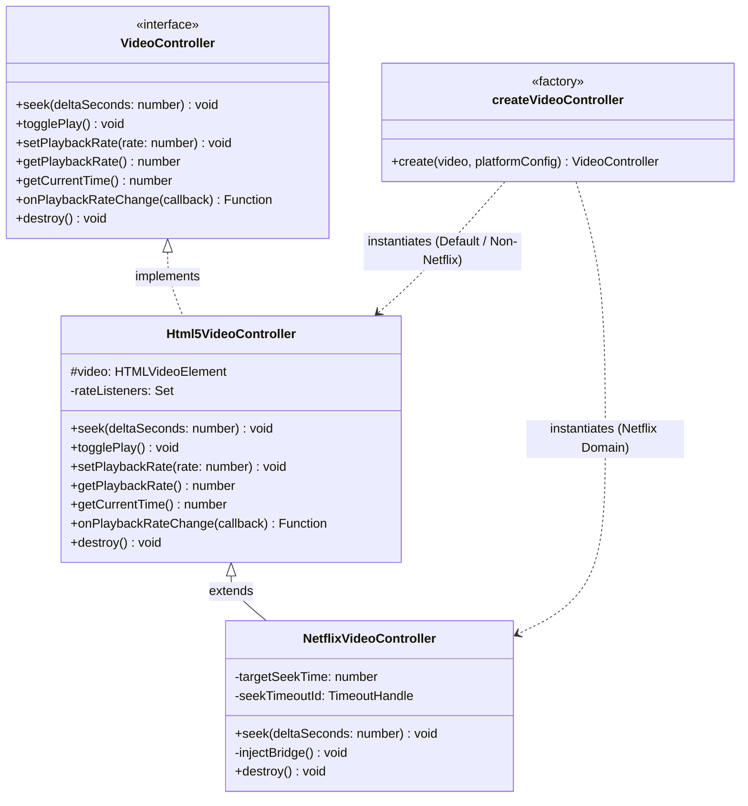
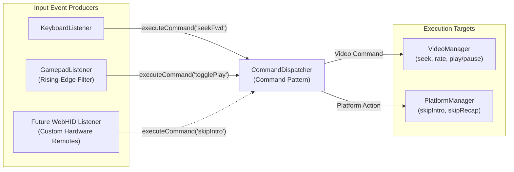

# BingeFlow — Engineering & Design Decisions (`DECISIONS.md`)

## Problem Framing & Origin

I found it hard to control videos on YouTube and streaming platforms: restricted video speeds, coarse seeks (+10s only), and some platforms don't have shortcuts for skipping intros (except Netflix).

I checked out popular extensions in the Chrome Web Store (Video Speed Controller being the most popular), but they fall short:

- Breaks in Netflix (seeking triggers buffer loops or player errors).
- Can't customize platform-specific behaviors (like skip intro, play next, etc.).

So I built my own extension: **BingeFlow**. Later, I added support to control it via a gamepad—which I don't think any existing Chrome extension in the Web Store does—so I can control playback from the couch. And crucially, seeking works flawlessly on Netflix without breaking the player.

---

## 1. Above & Beyond: Netflix Seeking via CSP-Compliant Main-World Bridge

### The Decision

I built a two-tier architecture that decouples the extension's content script (running in an isolated sandbox) from Netflix's main-world JavaScript context. The content script injects an unlisted script (`netflix-bridge.js`) into the DOM and passes seek commands across the boundary using native [`CustomEvent`](https://developer.mozilla.org/en-US/docs/Web/API/CustomEvent)s.

```
+-------------------------------------------------------------------------+
|                         ISOLATED WORLD (Content Script)                 |
|  - Listens to Keyboard/Gamepad shortcuts & Overlay UI                   |
|  - Calculates target seek timestamp                                     |
|  - Dispatches CustomEvent("bingeflow:netflix:seek", { detail })         |
+-------------------------------------------------------------------------+
                                    |
                            DOM Custom Event
                                    v
+-------------------------------------------------------------------------+
|                         MAIN WORLD (netflix-bridge.js)                  |
|  - Injected via <script src="chrome-extension://.../netflix-bridge.js">  |
|  - Accesses window.netflix.appContext.state.playerApp.getAPI()          |
|  - Retrieves active player session ID via getAllPlayerSessionIds()[0]   |
|  - Invokes player.seek(targetTimeMs) safely                             |
+-------------------------------------------------------------------------+
```

### The Alternatives

- **Mutating `video.currentTime` directly**: Works fine on YouTube and Prime Video, but crashes Netflix's player (error `NSES-500`) or triggers endless buffering loops because Netflix relies on an internal playback engine called Cadmium.
- **Inline `<script>` tag injection**: Appending inline JS string code into `<head>` gets blocked instantly by Netflix's strict Content Security Policy (`script-src`).
- **`chrome.scripting.executeScript({ world: 'MAIN' })`**: Requires intrusive `scripting` permissions and doesn't run cleanly as a continuous event listener in content script contexts.

### The Reasoning & Tradeoffs

To seek safely on Netflix, you have to call its internal Cadmium API:

```js
const player = window.netflix.appContext.state.playerApp
  .getAPI()
  .videoPlayer.getVideoPlayerBySessionId(sessionId);
player.seek(targetTimeMs);
```

Since content scripts can't read `window.netflix`, we have to execute code in the main world. Registering `netflix-bridge.js` as an unlisted entrypoint in WXT generates an authorized extension file. Injecting `<script src="chrome-extension://.../netflix-bridge.js">` satisfies Netflix's CSP.

To ensure this workaround never touches other platforms, I wrapped player operations in a Polymorphic Strategy & Factory pattern (`createVideoController`):



The factory checks `platform === "netflix"`. On YouTube, Prime Video, Disney+ Hotstar, etc., standard HTML5 `video.currentTime` is used. The Netflix bridge is 100% isolated to Netflix.

### What Was Deliberately Cut

- **Reverse-engineering Cadmium network buffers**: Trying to intercept stream chunks is brittle and breaks every time Netflix updates their player UI. Calling the official internal React API is stable.
- **Continuous polling**: The bridge sits completely idle until a seek event fires.

---

## 2. Product Thinking & UX: Gamepad Control & Decoupled Command Pipeline

### The Decision

I added [Web Gamepad API](https://developer.mozilla.org/en-US/docs/Web/API/Gamepad_API) support ([`navigator.getGamepads()`](https://developer.mozilla.org/en-US/docs/Web/API/Navigator/getGamepads)) and decoupled all input sources (keyboard, gamepad, overlay buttons) into a central `CommandDispatcher`.



### The Alternatives

- **Wiring gamepad buttons directly to DOM click listeners**: Leads to duplicate selector logic everywhere and tight coupling between inputs and actions.
- **Continuous analog stick scrubbing**: Calling `video.currentTime` on every animation frame while holding down an analog stick floods the media player with seek requests, causing audio popping and buffer stutters.

### The Reasoning & Tradeoffs

Binge-watching on a TV or external monitor means you aren't sitting at your keyboard. A wireless Xbox or PlayStation controller on the couch is the best media remote.

Using the Command Pattern means input sources just emit action strings like `"seekFwd"`, `"skipIntro"`, or `"togglePlay"`. Adding new inputs (like gamepad buttons or custom Bluetooth remotes via [WebHID API](https://developer.mozilla.org/en-US/docs/Web/API/WebHID_API)) takes zero changes to playback logic.

For gamepad seeking, I implemented **discrete step seeking with rising-edge filtering**:

- Holding a button fires the action **once** per press instead of 60 times per second.
- On Netflix, rapid presses accumulate seek offsets into `targetSeekTime` with a 1.5s debounce before executing, avoiding out-of-order frame fetches.

### What Was Deliberately Cut

- **Macro recorder UI**: Let users map key combinations felt like overkill. A simple 1-to-1 mapping for common media actions covers almost all real usage.
- **Custom per-controller button remapping matrix**: Standard Web Gamepad API normalizes button indices across Xbox, PlayStation, and generic USB controllers out of the box.

---

## 3. UX Decisions: Isolated Shadow DOM Overlay

### The Decision

I built a floating control overlay (`OverlayHandle`) rendered inside an open [Shadow DOM](https://developer.mozilla.org/en-US/docs/Web/API/Web_components/Using_shadow_DOM) ([`attachShadow()`](https://developer.mozilla.org/en-US/docs/Web/API/Element/attachShadow)) attached directly to the platform's video container element (`playerContainer`).

```
[ Streaming Platform Video Container ]
 ├── <video>
 └── <div id="bingeflow-overlay-host">
      └── #shadow-root (open)
           ├── <style> scoped overlay.css </style>
           └── <div class="si-overlay"> (Controls: Seek, Speed, Reset, Drag Handle)
```

### The Alternatives

- **Injecting raw HTML into `document.body`**: Host sites (like Prime Video or Hotstar) have aggressive global CSS resets (`button { all: unset }` or `* { box-sizing: content-box }`). Direct DOM injection causes extension buttons to break visually or ruin host page layouts.

### The Reasoning & Tradeoffs

- **Style Isolation**: Shadow DOM isolates BingeFlow styles from host site CSS resets completely.
- **Fullscreen Support**: Mounting inside the video container wrapper (`z-index: 2147483647`) ensures the overlay stays visible when entering browser native fullscreen mode.
- **5-Second Autohide**: An automated timer hides the overlay after 5 seconds of mouse inactivity so it doesn't obstruct what you're watching.
- **Percentage-Based Coordinates**: Dragging uses [`setPointerCapture()`](https://developer.mozilla.org/en-US/docs/Web/API/Element/setPointerCapture) to compute relative `%` top/left coordinates, keeping the overlay anchored properly when resizing browser windows or switching resolutions.

### What Was Deliberately Cut

- **Duplicate timeline scrubber bar**: Platform video players already have scrubbers. Adding another timeline bar adds useless visual clutter.

---

## 4. Tech Stack & Engineering Setup (WXT + SolidJS + TypeScript + pnpm)

### The Decision

I chose **WXT** for the browser extension framework, **SolidJS** for popup/options views, **TypeScript** for type safety, and **pnpm** for package management.

### The Alternatives

- **Plasmo**: Older Parcel-based bundler with rigid file structures. Configuring unlisted main-world scripts (`netflix-bridge.js`) is cumbersome.
- **React**: ~40KB+ bundle overhead and Virtual DOM diffing is unnecessary for short-lived popup UIs.
- **Svelte 5**: Enforces strict single-file components (`.svelte`). SolidJS allows co-locating multiple small JSX components in one file during fast iteration, and standard JSX syntax keeps code simple.

### The Reasoning & Tradeoffs

- **WXT**: Builds Chrome MV3 and Firefox MV3 from a single codebase. Handles manifest generation, entrypoints, and hot module reloading cleanly.
- **SolidJS**: Fine-grained reactive signals (`createSignal`) compile directly to DOM operations without Virtual DOM overhead, achieving sub-50ms popup open times.
- **pnpm**: Fast, disk-efficient dependency management with lockfile determinism. Setup for a new developer is literally just `pnpm install && pnpm dev`.

### What Was Deliberately Cut

- **External State Libraries (Redux, Zustand)**: Popups are short-lived. SolidJS signals backed by `browser.storage.sync` helpers are more than enough.

---

## 5. Product Thinking & Performance: Per-Site Isolation

### The Decision

BingeFlow checks domain enablement on content script initialization (`if (!isEnabled) return`) and uses a per-site enablement list stored in [`browser.storage.sync`](https://developer.mozilla.org/en-US/docs/Mozilla/Add-ons/WebExtensions/API/storage/sync).

### The Alternatives

- **Running content scripts indiscriminately on every site with a `<video>` tag**: Causes annoying overlay popups on news sites, landing pages with background hero videos, or video ads.

### The Reasoning & Tradeoffs

- **Zero CPU/RAM overhead on non-streaming sites**: If a user is on Wikipedia or Github, the extension exits immediately upon initialization.
- **Sensible defaults**: Ships enabled by default on supported platforms (Netflix, Prime Video, YouTube, Disney+ Hotstar). Users can enable/disable any custom site in one click via the popup.

### What Was Deliberately Cut

- **Custom cloud sync backend**: Using `browser.storage.sync` syncs settings across devices automatically via browser user profiles without privacy risks or extra servers.

---

## 6. Testing Strategy & Quality Assurance

### The Decision

I wrote targeted unit and integration tests focusing on critical internal logic contracts rather than full end-to-end DOM rendering.

### The Reasoning & Tradeoffs

We test what we actually control:

1. **CustomEvent Bridge Contract**: Verifying seek detail serialization and timestamp bounds.
2. **Input Dispatcher & Gamepad Debounce**: Testing button state transitions and accumulation logic under rapid triggers.
3. **Platform Matcher**: Ensuring URL regular expressions match intended platform domains accurately.

This gives high confidence in real failure modes without brittle CI failures.

---
