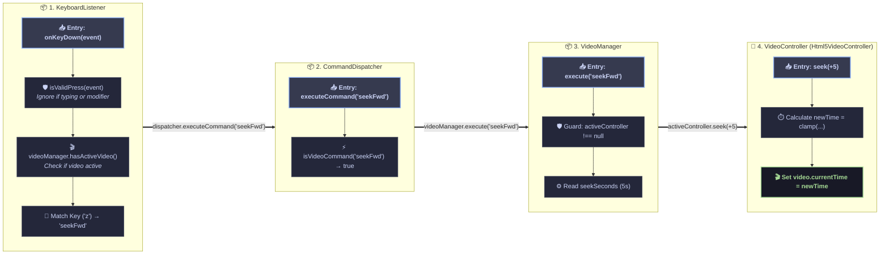
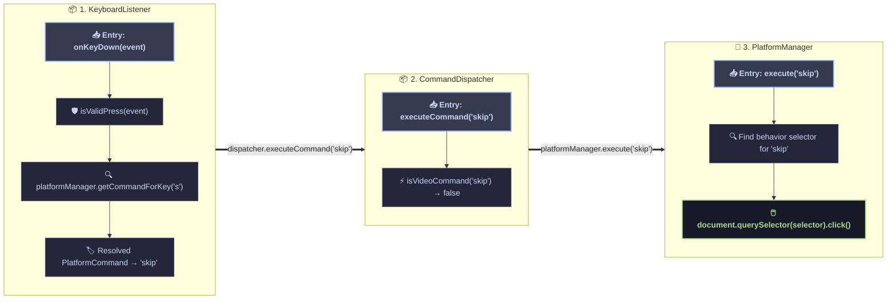
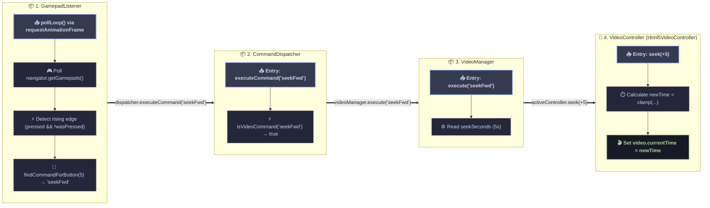
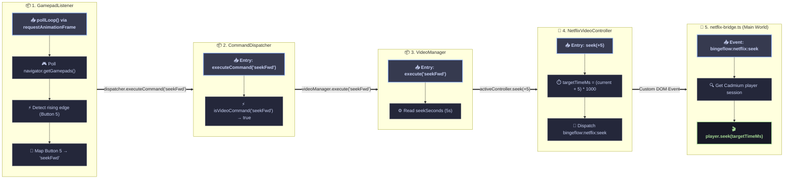

# BingeFlow Execution Journeys

This document visualizes end-to-end execution flows across components in BingeFlow.

---

## 1. Keyboard Press `z` (Seek +5s in HTML5 Video)

This journey traces what happens when a user presses a keyboard shortcut key (e.g., `'z'`) to seek standard HTML5 video forward:

---

## 2. Keyboard Press `z` (Seek +5s in Netflix)

This journey traces what happens when a user presses a seek key on Netflix, routing through the main-world bridge to Cadmium API:

```mermaid
graph LR
    %% Styling
    classDef entryNode fill:#363a4f,stroke:#8aadf4,stroke-width:2px,color:#cad3f5,font-weight:bold;
    classDef stepNode fill:#24273a,stroke:#494d64,stroke-width:1px,color:#cad3f5;
    classDef targetNode fill:#181926,stroke:#a6da95,stroke-width:2px,color:#a6da95,font-weight:bold;

    subgraph C1 ["📦 1. KeyboardListener"]
        direction TB
        KL_1["📥 Entry: onKeyDown(event)"]:::entryNode
        KL_2["🛡️ isValidPress(event)"]:::stepNode
        KL_3["🔑 Match Key ('z') → 'seekFwd'"]:::stepNode
        KL_1 --> KL_2 --> KL_3
    end

    subgraph C2 ["📦 2. CommandDispatcher"]
        direction TB
        CD_1["📥 Entry: executeCommand('seekFwd')"]:::entryNode
        CD_2["⚡ isVideoCommand('seekFwd') → true"]:::stepNode
        CD_1 --> CD_2
    end

    subgraph C3 ["📦 3. VideoManager"]
        direction TB
        VM_1["📥 Entry: execute('seekFwd')"]:::entryNode
        VM_2["⚙️ Read seekSeconds (5s)"]:::stepNode
        VM_1 --> VM_2
    end

    subgraph C4 ["🔌 4. NetflixVideoController"]
        direction TB
        VC_1["📥 Entry: seek(+5)"]:::entryNode
        VC_2["⏱️ targetTimeMs = (current + 5) * 1000"]:::stepNode
        VC_3["📡 Dispatch bingeflow:netflix:seek"]:::stepNode
        VC_1 --> VC_2 --> VC_3
    end

    subgraph C5 ["🎯 5. netflix-bridge.ts (Main World)"]
        direction TB
        NB_1["📥 Event: bingeflow:netflix:seek"]:::entryNode
        NB_2["🔍 Get Cadmium player session"]:::stepNode
        NB_3["🎬 player.seek(targetTimeMs)"]:::targetNode
        NB_1 --> NB_2 --> NB_3
    end

    C1 ==>|"dispatcher.executeCommand('seekFwd')"| C2
    C2 ==>|"videoManager.execute('seekFwd')"| C3
    C3 ==>|"activeController.seek(+5)"| C4
    C4 ==>|"Custom DOM Event"| C5
```

---

## 3. Keyboard Press for Platform Behavior (e.g., Skip Intro / Next Episode)

This journey traces what happens when a keypress triggers a platform-specific button click (such as clicking the "Skip Intro" button):

---

## 4. Gamepad Press Seek +5s (HTML5 Video)

This journey traces what happens when a gamepad button (e.g. `R1` / Button 5) is pressed to seek standard HTML5 video forward:

---

## 5. Gamepad Press Seek +5s (Netflix Video)

This journey traces what happens when a gamepad button is pressed on Netflix, routing through the main-world bridge:

